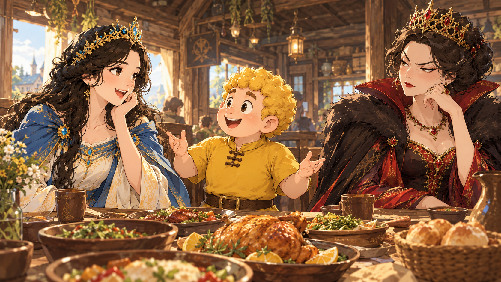

一路上，如魔镜说的，路途颠簸遥远，王后从没吃过这种苦，累得她睡着了。

“王后，前面有个饭馆，我们去吃饭，顺便歇一下。”

等王后睁开眼，看到白雪公主已经下了车，正掀起车帘叫醒她。

“你先去，先点好饭菜，我等下再去。”

于是白雪公主先走向饭馆。

过了一会儿，王后才走进来。

这饭馆真寒酸，她一辈子没进过这么寒酸的饭馆，还是木头搭建的，但荒郊野外又没办法。

“店小二呢？给我倒杯咖啡！”

“我们没有咖啡，只有茶和水。”

一个声音传来，王后四处张望，却不见人。

“人呢？怎么只有声音，不见人？”

“我就在您旁边呢，你往下看。”

王后往下一看，才发现店小二是个小矮人，还不到她腰部高呢，天哪，连店员都这么丑！

但没办法，只好将就。

吃饭时，王后隐约听到大家窃窃私语，称赞白雪公主漂亮，她不禁白了白雪公主一眼。

特别是掌柜和店小二，都是小矮人，一共七个，他们对白雪公主非常殷勤，一会一个跑过来问白雪公主饭菜合不合胃口，一会另一个又过来问要不要加菜，等等。

等结账时，他们更免去了白雪公主的餐费。

但转头却向她收一千元餐费。

“她免费，我却要一千元？什么道理？简直是黑店！我要告你们！”

“夫人，您点了这么多菜，是这位姑娘的十几倍，一千元一点都没多算，而且您要这要那的，我们店员伺候您都跑断腿了！”

这店里的菜实在难吃，王后点了一道又一道，但每道菜都几乎没吃过，因为没一样合她胃口。

王后自知理亏，“哼”了一声，气恼丢下钱走出门。

魔镜看到王后气冲冲回来，它一看就知道怎么回事了。

“王后，一千元对你来说又不是什么大数目，何必为这个生气？”

“这是一千元的问题吗？是面子！这些小矮人，看到白雪公主长得漂亮，就给她免费，却收了我一千大元！”

“王后，其实……”

“闭嘴吧！又要说什么不是因为她的美貌对不？”

