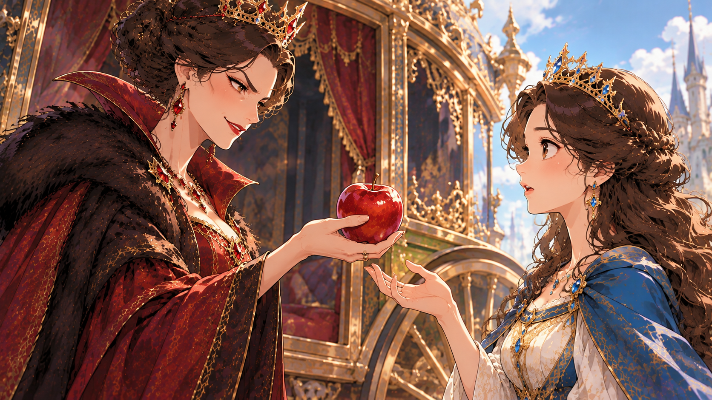

原来，王后是巫婆，她施展魔法，把这个苹果炮制成世界上最毒的毒苹果：只要吃一口，就会变成世界上最丑的女人！

她把白雪公主叫来，把苹果递给她，装作亲切地说：“刚才路边有棵苹果树，我顺便摘的，可甜了，你也尝尝。”

白雪公主看着红彤彤的苹果，一看就知道又甜又多汁，她吞了吞口水，把苹果推回去说：“您自己吃，一路上太辛苦了，又没什么好吃的，您留着自己吃。”

“吃吧吃吧，我已经吃过了，这是专门留给你的。”

王后急了，她就怕白雪公主不吃。

于是，白雪公主接过苹果，咬了一口。

果然又甜又多汁！

但是，就在这时，她又白又嫩的皮肤变得黝黑又粗糙，乌黑光亮的头发失去光泽，变得乱糟糟像鸟窝一样……，世上最美丽的白雪公主变得丑陋不堪。

王后一看乐坏了：白雪公主终于变成最丑的女人！看你还怎么说服南邻国！还想成为南邻国王子的王妃？做梦！

她不用担心王后的地位不保了，如今，她要代替白雪公主说服南邻国，国王肯定会把城堡送给她，说不定连王位也会传给她！

再说白雪公主见自己突然大变样，她又害怕又伤心，哭了起来。

“公主，公主，别怕，别伤心，我们都喜欢你，不是因为你的样貌，我们还是一样喜欢你！”

白雪公主一看，是一只小鸟。

“对呀，对呀，我们还是喜欢你！”

后面来了小鹿、小马，……，各种动物。

最后，小鸟通知了小矮人，他们也赶来了。

这一夜，在大家的安慰下，白雪公主重新振作了。

她擦干眼泪说：“快到南邻国了，我不能为自己的容貌伤心，我得打起精神，说服南邻国帮助我们打败东邻国才行！否则打起仗来，老百姓受苦，你们小动物也不好过。”

可是王后把白雪公主的王冠、礼服、还有那封最重要的宴会邀请信，一并偷走，然后悄悄坐着马车离开了。

因此等白雪公主到了南邻国的王宫门前，门卫说什么都不让她进去。
