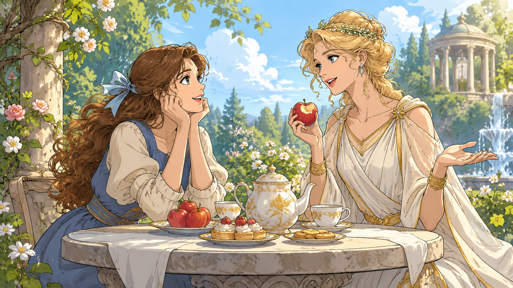

灰姑娘遇到仙女后，就跟着她学魔法。

有一天，她回家后，做了一些好吃的，请仙女吃，又求她说：“仙女，我求求你，帮我建座孤儿院吧，小小的，只要小小的就行……”

原来，冬天快到了，她在街上不时看到有孤儿吃不饱穿不暖，她别提多担心了。

于是萌生了建孤儿院的念头。

仙女是个年轻的小仙女，她最爱吃灰姑娘做的东西，她边不停地把食物往嘴里送，边说：“建孤儿院？容易是容易，只要我魔法棒一挥，平地就能变出一座孤儿院！但是，平地在哪呢？总不能随便占用公共地方吧？”

“那怎么办呢？”

灰姑娘皱起眉头。

“只要你愿意，对你来说也很容易，去求王子呀，我早说过，你迟早会成为王妃，到时你想建多少座、多大的孤儿院都行！”

“我说了我不想当王妃，我要跟你学魔法！”

“你当了王妃，一样可以和我学魔法呀，明天王子就要举行盛大的舞会，全城的姑娘都去了，你也去参加吧！”

“我又不认识王子，怎么知道他是怎样的人？怎么能当王妃？还有别的办法吗？”

“也是有的，公爵大人也有这个权力。”

“那我就去求公爵大人，在哪里能见到他呀？”

“他是王子的伯父，明天也会去王子的舞会。”

“还是得去舞会呀？可去舞会得有漂亮的礼服，否则连王宫的大门都进不去，我一件礼服都没有，怎么去呀？”

“这个还不容易？”

仙女放下食物，拍了拍手，拿起魔法棒，对着花园中晾着的衣服一挥，灰姑娘三套破旧的衣服，立即变成三套金光闪闪的礼服！

“天……天哪……”

灰姑娘都惊呆了，虽然她没有漂亮的礼服，但也见过继母和姐姐们昂贵的礼服，没一件能和这三件相比的！

“这三套，你随便选一套，保证比任何人都漂亮！”

“我只要一套就行。”

“但你记住，过了午夜12点，魔法就会消失，礼服会变回破衣服，所以你必须赶在午夜12点前回来！”

为了孩子们，灰姑娘把礼服收起来，准备明天去参加舞会。

但这一幕，被她的继母和两个姐姐看到了。
