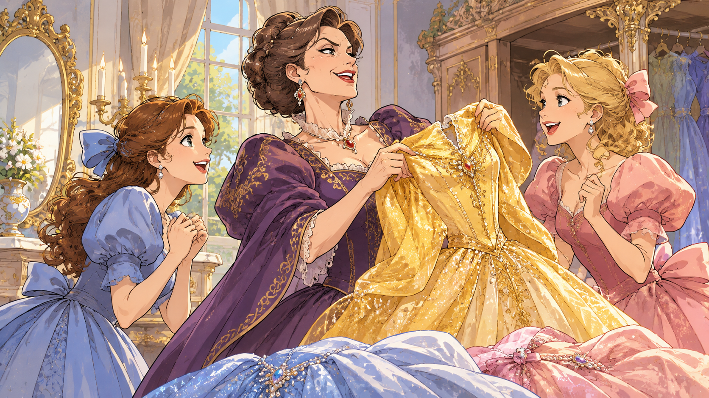

继母和她两个女儿，在花园偷听到灰姑娘和仙女的对话。

“看来巫婆说的是真的，真有仙女帮她，她才能当上王妃！”

原来，灰姑娘当上王妃后，继母母女三人心里很不平衡，偶然从一个巫婆那里得知，有仙女帮灰姑娘，还变出了三套漂亮的礼服给她去舞会穿。

她们花重金求巫婆让时光倒流，回到过去，她们要亲眼看看怎么回事。

巫婆答应了。

现在她们看到真有仙女帮灰姑娘。

“就是靠着这么漂亮的礼服，王子才喜欢她，她才能当上王妃！”

“没错，如果我们也穿上这么漂亮的礼服，王子肯定会选我们当王妃，哪轮得到她！”

“妈妈，我们该怎么办？”

“那还用说？肯定是把礼服抢过来！”

三人看到灰姑娘屋里的灯熄灭了，知道她睡着了，于是悄悄摸到她房门口，推开门，把衣柜里三套礼服都拿走了。

回到自己房间，她们迫不及待，兴奋地试穿起来。

两个女儿却同时选中同一套，于是抢了起来。

“是我先拿的！”

“我先看中的！”

两人争得面红耳赤。

“行了，”继母把衣服抢过来，对她们说，“真没出息！这里有三套呢，抢什么！记住，你们共同的敌人是灰姑娘，不是你们自己！只要你们其中一个当了王妃，另一个想当王妃，有的是机会！即便当不了王妃，也可以是公爵夫人、伯爵夫人！到时有你们穿不完的漂亮礼服！为了避免你们争抢，你们选其他两套吧。”

两姐妹觉得有道理，于是不再抢，分别选了另外两套。

“妈妈，还剩下最漂亮的一件，难道要留给灰姑娘吗？”

“做梦！肥水不流外人田，这件当然是我穿！”

继母边说边穿上剩下的那件礼服，虽然实在太小了，但她还是硬塞了进去。

第二天，她们找个借口打发灰姑娘外出干活，然后就穿上礼服，打扮得漂漂亮亮去参加王宫的盛大舞会了。

临走前，继母把家里剩余的马车都锁了起来。

“妈妈，干嘛把马车锁起来？”

“这样就确保灰姑娘去不了王宫了，这里离王宫远着呢，没马车她怎么去王宫！”

“还是妈妈想得周到，王妃的位置肯定是我们的了！”

她们三个哈哈大笑，坐上马车直奔王宫。
