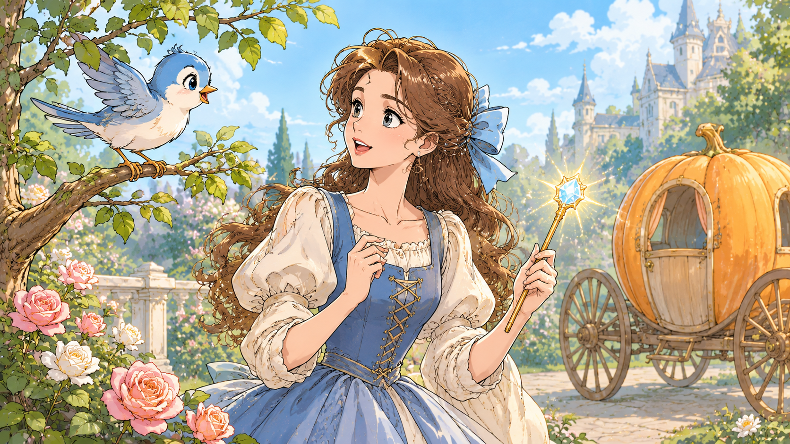

灰姑娘在外面做完事，匆匆回到家，正打算换上礼服去王宫参加舞会。

当她打开衣柜，却愣住了：三套漂亮的礼服全不见了！一件都没有！

她急匆匆跑出去，来到花园，到处找起来：难道是老鼠偷走了吗？

正当她急得团团转，就听一个声音说：“别找了，礼服昨晚就被你继母和她的女儿偷走了，她们一人一套，现在她们正穿着你的礼服去王宫参加舞会呢！”

灰姑娘一看，是树上的小鸟。

“她们竟然偷走了礼服？小仙女呢？我得求求仙女再帮我才行！”

“小仙女一大早就走了，南山仙女摆宴请客，小仙女最爱吃，一收到请帖，第一时间就赶去南山了。”

“这可怎么办？没有礼服，没有马车，我怎么去王宫？”

灰姑娘着急地四下张望，看到花园里种的南瓜，忽然灵机一动。

“有了！”

她跑回屋里，很快又跑回来，手里多了根魔法棒，这是她为了跟小仙女学魔法特地做的。

她对着一个大南瓜挥动魔法棒。

“南瓜南瓜，变！”

大南瓜竟立即变成了一驾马车。

小鸟惊呆了：“灰姑娘，你可真行！学得可真快，都会变魔法了，不过，这马车，样子有点普通，去王宫参加舞会的公主小姐们坐的可都是豪华马车。”

“毕竟我的魔法还是初级，变不出豪华马车，”灰姑娘不好意思地笑笑，“不过没关系，我又不和公主小姐们比，只要能去王宫，见到公爵大人就行。”

“车有了，但马呢？没有马，车怎么跑呢？”

这是灰姑娘看到两只老鼠经过，她立即有了主意。

“看我的！”

她魔法棒一挥，两只老鼠立即变成两匹马，老实地套在马车上。

“马和车都有了，可你没有礼服，穿着这身又破又旧的衣服去，恐怕连王宫大门都进不了！”

“看我的！”

灰姑娘魔法棒又一挥，她身上的破衣服，立即变成了新衣服。

小鸟看了又说：“嗯，衣服是不破了，可惜不是礼服，要进王宫也不容易！”

灰姑娘说：“都怪我魔法还浅，如果不能进王宫，再想办法。”

小鸟说：“好吧，你平常很照顾我，我也帮你一把才行，王宫右边围墙，有个小门，你只要叫‘鹦鹉鹦鹉，我是灰姑娘，快快开门’，它就会给你开门，它是我朋友，也是王后的宠物，我等下叫白鸽给它传话。”

“太感谢你了，小鸟！”

灰姑娘又沉思地说：“不过，我没见过公爵大人，去舞会的人肯定很多，到时不知道怎么找他呢！”

“这个好办，我经常去王宫探望朋友，王亲贵族我都认得，只要你看到一位穿着深蓝天鹅绒礼服，佩戴金色鹰徽勋章，胡子花白，有点发胖的老人，那就是公爵大人！”

灰姑娘再次感谢小鸟，坐上马车。

“没有马夫，怎么驾马呢？”

“继母她们外出，经常让我驾马，所以我会驾马。”

说着灰姑娘一挥鞭，马车载着她往王宫而去。

小鸟望着她的背影说：“灰姑娘真是什么都会啊，我想她肯定会成功的。”