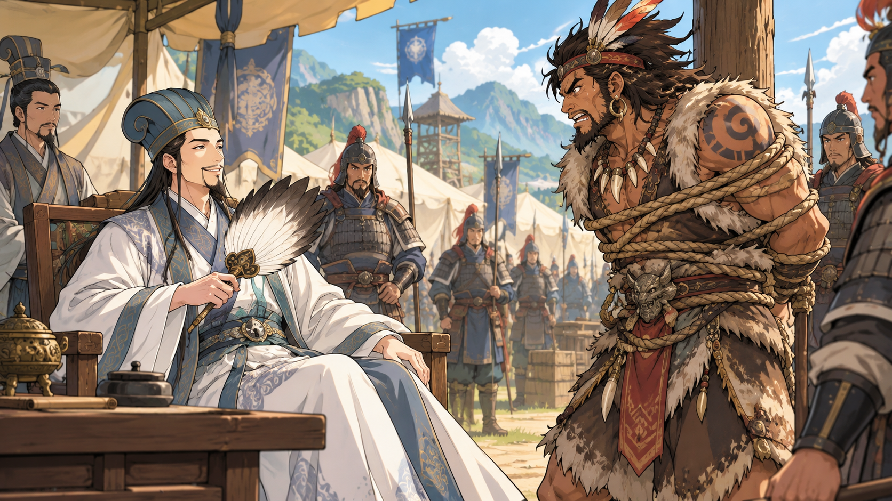

欲擒故纵是个成语，也是三十六计之一，意思是：想抓住对方，却故意先放了他。

诸葛亮就是用欲擒故纵这条计谋，七擒七纵孟获，让孟获心悦诚服，归顺他的。

孟获是一个脾气很犟的酋长，他不服蜀国，派出十万兵攻打它。

诸葛亮是蜀国的丞相，他下令说：“捉住孟获，但一定要活捉，不要伤害他，一定要以礼相待。”

他的下属很困惑：“丞相，他都来攻打我们了，你还说不要伤害他，还要以礼相待？”

诸葛亮微笑说：“以后你们就知道了，我这么做是有理由的。”

将士们只好照做，不久，他们终于活捉了孟获。

诸葛亮亲自来见孟获，还让人拿来椅子给他坐，问他有没有受伤，饭菜吃得习惯吗，表现得十分礼貌客气。

将士们心里不禁嘀咕：这哪里是审问，分明是在招待客人呢。

但孟获却气呼呼地说：“少给我来这一套！我会败给你，还不是你耍诈！我不服！要杀要砍随你便！”

诸葛亮呵呵笑道：“既然孟将军不愿意呆在我这里，我这就放你走！”

将士们一听，赶紧说：“丞相，放他走不是放虎归山吗？万万不可呀！”

但是，诸葛亮还是让人解开孟获的绳子，还亲自把他送出军营。

等孟获出了军营，他简直不敢相信自己的眼睛：就这么把我放了？

他哈哈大笑说：“都说诸葛亮聪明绝顶，我看是个糊涂虫！连他的属下都知道这是放虎归山，我看他还不如他属下呢，这次，我要让他输个彻底！”

于是孟获更加小心和诸葛亮对抗。

但是，很不幸，他再次被诸葛亮活捉了。

但是他还是不服，诸葛亮哈哈大笑，亲手解开绳子，再次把他送出军营。

就这样，抓了放，放了抓，……，连续六次，即便孟获换了新战术，请了厉害的帮手，都被诸葛亮攻破活捉。

而每一次，诸葛亮不但没伤害他，反而请他喝酒吃肉，嘘寒问暖，然后微笑着把他送出军营。

到了第七次，孟获请来了藤甲兵，藤甲兵穿着“藤甲”，刀枪不入，但还是被诸葛亮的火攻打得落花流水。

当孟获第七次被活捉带到诸葛亮面前时，没等诸葛亮开口，他就跪下说：“丞相用兵如神，我心服口服，从此愿意归顺蜀国！”

诸葛亮呵呵笑着扶起他，令人大摆宴席庆贺。

将士们问诸葛亮说：“丞相，我们总算解决了孟获，但是，七擒七纵不是太费劲了吗，为什么要这么做呀？”

诸葛亮说：“孟获是酋长，如果杀了他，其他部落只会怨恨我们，一旦有机会肯定会攻打我们，如果能让孟获心服口服归顺，他们也会跟着一起归顺，不是比武力要强一百倍吗？”

大家恍然大悟，齐声称赞：“丞相英明！”
